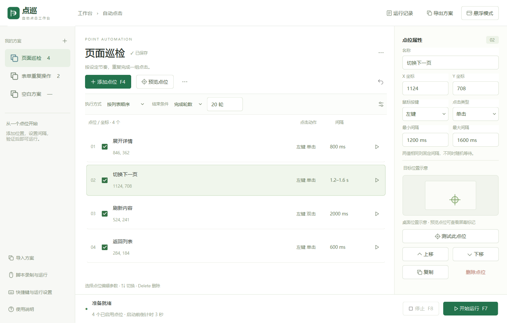

<div align="center">

# 点巡

<br>


<div>
    
</div>
<div>
    
</div>
<br>

[简体中文](README.md) | [English](README_en-US.md)

</div>

点巡是桌面自动点击工作台，可管理多个点击方案，按顺序、随机或指定方式重复点击，也可录制并重放鼠标和键盘操作。

- 方案自动保存，支持复制、导入、导出与点位撤销。
- 点位可设置坐标、鼠标按键、单击/双击及固定或随机间隔。
- 支持倒计时、点击数/轮数/时长限制、暂停、停止与悬浮控制。
- 脚本执行失败时显示具体动作位置，并恢复可操作状态。


# 目录

+ [安装](#安装)
+ [使用方法](#使用方法)
  + [基本操作](#基本操作)
  + [提示](#提示)
  + [脚本语法说明](#脚本语法说明)
+ [开源贡献者](#开源贡献者)

# 安装

点巡使用 `Python` 编写。按下方说明打包后，可直接运行 `dist/点巡.exe`。

### 源码打包可执行文件

```
1. 安装 Python3
2. pip安装依赖
- (Windows) pip install -r requirements-windows.txt
- (Linux/MacOS) pip3 install -r requirements-universal.txt
3. pip安装pyinstaller
-  pip install pyinstaller
4. pyinstaller打包
- (Windows) pyinstaller 点巡.spec
- (Linux X11) pyinstaller -F -w --add-data "./assets:assets" --hidden-import "pynput.keyboard._xorg" --hidden-import "pynput.mouse._xorg" 点巡.py
- (Linux Wayland) pyinstaller -F -w --add-data "./assets:assets" --hidden-import "pynput.keyboard._uinput" --hidden-import "pynput.mouse._uinput" 点巡.py
- (MacOS) pyinstaller -F -w --add-data "./assets:assets" --hidden-import "pynput.keyboard._darwin" --hidden-import "pynput.mouse._darwin" 点巡.py
```

打包完成后，可执行文件在项目路径的`dist`文件夹内。

# 使用方法

## 基本操作

### 桌面模式

自动点击：创建方案后，用 `添加点位` 或 `F4` 选择屏幕位置，在右侧编辑点位属性。设置执行方式和结束条件后，按 `F7` 开始；运行中 `F7` 暂停或继续，`F8` 停止。默认启用鼠标移到屏幕左上角停止。

录制与重放：在左侧打开 `脚本录制与运行`，按下面的步骤操作。

1、点击 `录制` 按钮，开始录制。

2、在计算机上进行任意操作，如点击鼠标、键盘输入，这部分的动作会被记录下来。

3、点击 `结束` 按钮，结束录制。

4、点击 `启动` 按钮，计算机会重复执行一遍第2步中所录制的动作。

### 命令行模式

直接运行指定脚本:
```
> ./点巡 scripts/0314_1452.txt
```

运行指定脚本3次:
```
> ./点巡 scripts/0314_1452.txt -rt 3
> ./点巡 scripts/0314_1452.txt --runtimes 3
```

## 提示

1、可设置脚本重复执行的次数，如果为 `0` 即为无限循环。

2、默认启动热键为 `F6`，功能等同于 `启动` 按钮；默认终止热键为 `F9`，按下后将会停止正在运行的脚本。

3、录制时只记录鼠标点击动作和键盘动作，不记录鼠标移动轨迹。

4、每次录制结束后都会在 `scripts` 目录下生成一个新的脚本文件。Windows 打包版将配置、方案、脚本和日志保存在 `%LOCALAPPDATA%\点巡`，源码运行则使用项目目录。

5、运行前可以在列表中选择一个需要执行的脚本。

6、`scripts` 下的脚本文件内容可以修改，修改时可参考如下所述 `脚本格式说明`。

7、热键设置中的`Middle`指代鼠标中键，`XButton`指代鼠标侧键

8、由于程序速度受限，当输入的鼠标速度大于一定值时脚本将无法以预期的输入速度执行

9、部分系统环境中，可能出现无法录制完整的鼠标事件的情况，请以管理员身份/root身份运行此工具即可正常使用。

10、使用Mac的用户，需要确保程序在辅助功能白名单，如果使用打包的exec文件，则还需要确保终端也在辅助功能白名单。 如果app程序闪退，请尝试给予`~/.qt_material`目录下文件的写权限:
```bash
chmod -R 770 ~/.qt_material
```

11、对于Linux/Mac用户，如果在以管理员身份运行后仍然存在无法录制或执行的问题，可以参考[pynput的文档](https://pynput.readthedocs.io/en/latest/limitations.html)

## 脚本语法说明
> 演示屏幕分辨率为`1920 * 1080`

脚本为 `json5` 格式，每个最内层的jsonobject代表一个事件
```json5
{
  scripts: [
    // 开始运行 `3000ms` 后，在屏幕相对坐标 `(0.05208, 0.1852)`即 `(100,200)` 处 `按下鼠标右键`；
    {type: "event", event_type: "EM", delay: 3000, action_type: "mouse right down", action: ["0.05208%", "0.1852%"]},
    // 等待 `50ms` 后在相同位置 `抬起鼠标右键`；
    // 横纵坐标为[-1, -1]时，表示在鼠标当前所在位置执行操作。
    {type: "event", event_type: "EM", delay: 50, action_type: "mouse right up", action: [-1, -1]},
    // 等待 `1000ms` 后 `按下f键`；
    {type: "event", event_type: "EK", delay: 1000, action_type: "key down", action: [70, 'F', 0]},
    // 等待 `50ms` 后 `抬起f键`；
    {type: "event", event_type: "EK", delay: 50, action_type: "key up", action: [70, 'F', 0]},
    // 等待 `100ms` 后，在屏幕相对坐标 `(0.2604, 0.4630)`即 `(500, 500)` 处 `按下鼠标左键`；
    {type: "event", event_type: "EM", delay: 100, action_type: "mouse left down", action: ["0.2604%", "0.4630%"]},
    // 等待 `100ms` 后，鼠标移动至相对坐标 `(0.2604, 0.5556)`即 `(500, 600)` 位置；
    {type: "event", event_type: "EM", delay: 100, action_type: "mouse move", action: ["0.2604%", "0.5556%"]},
    // 等待 `100ms` 后，在屏幕相对坐标 `(0.3125, 0.5556)`即 `(600, 600)` 处 `抬起鼠标左键`；
    {type: "event", event_type: "EM", delay: 100, action_type: "mouse left up", action: ["0.3125%", "0.5556%"]},
    // 等待 `100ms` 后，在当前位置输入 `你好 world` 文字。
    {type: "event", event_type: "EX", delay: 100, action_type: "input", action: "你好 world"}
  ]
}
```


## 高级功能

脚本语法见本说明中的“脚本语法说明”章节。工作台验证记录见 [docs/WORKBENCH_VERIFICATION.md](docs/WORKBENCH_VERIFICATION.md)。


# 开源贡献者


如果您是开发者，欢迎基于点巡源码参与改进。

感谢 JetBrains 免费提供开发工具

<a href="https://www.jetbrains.com/"></a>
